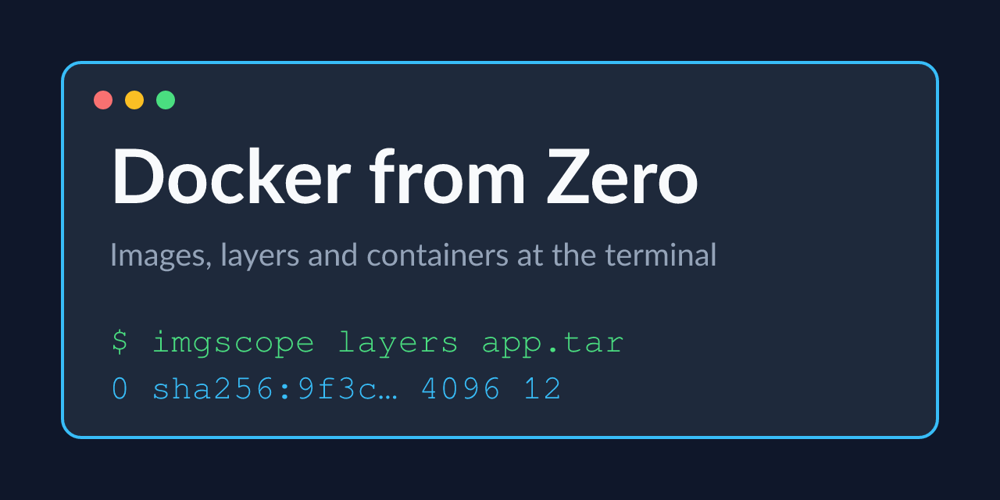

# Docker Compose Stacks

Services, networks, volumes and healthchecks that start in order.

Tested Rust code for the third course of the Docker specialization: stackd is a small HTTP counter that Compose runs with a volume, a healthcheck and a dependent client.

## Examples

| example | what it does |
|---|---|
| [`examples/stackd`](examples/stackd) | an api with a healthcheck and volume, and a client that waits for it |

## Prerequisites

- Docker 25 or newer with Compose v2
- Rust 1.80 or newer
- A Linux or macOS terminal

---

Generated — do not edit by hand. Edit `course.toml` and re-render.
